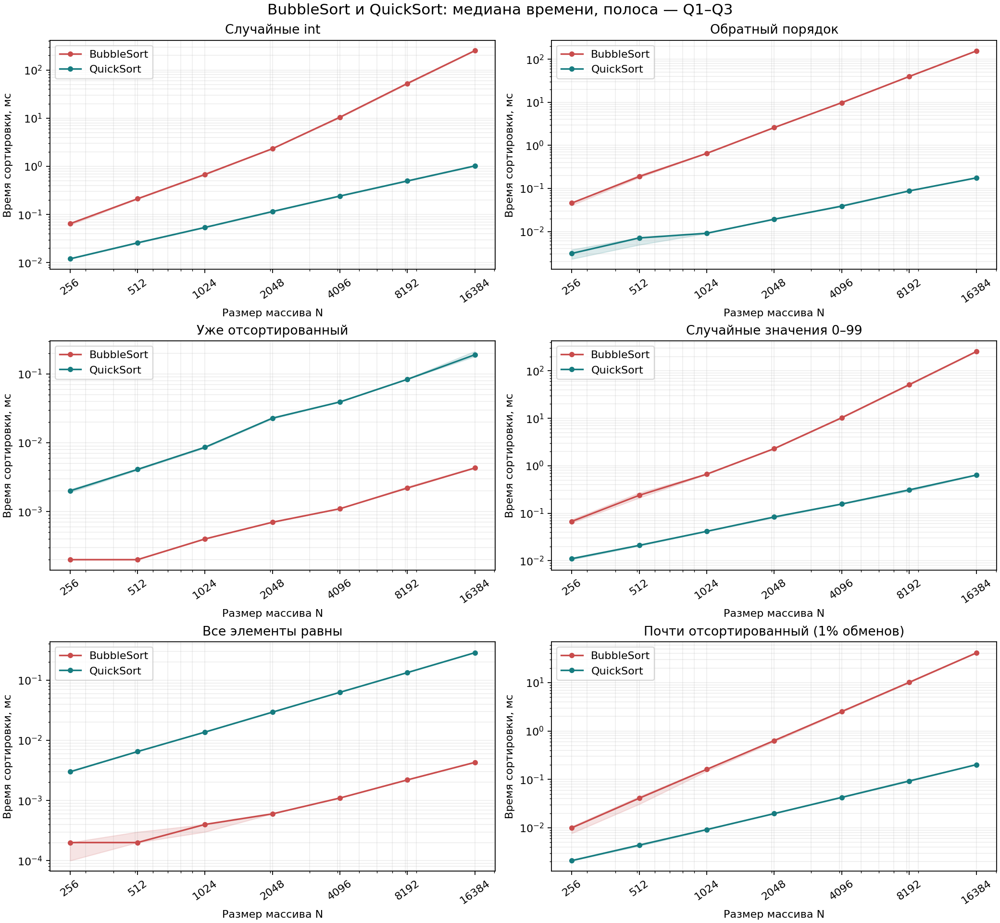
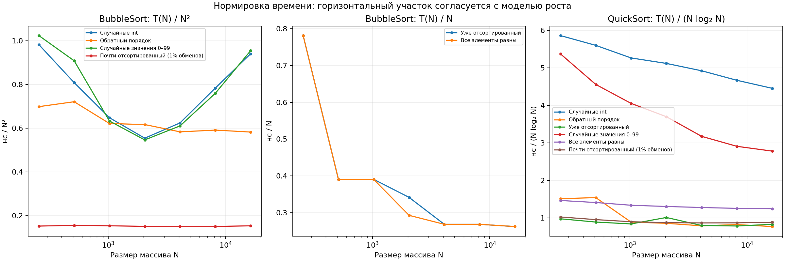

# Результаты измерений

Файл построен автоматически по `raw.csv`; времена не являются теоретическими оценками.

Размеры: 256, 512, 1024, 2048, 4096, 8192, 16384. Повторений на точку: 9.
Единица исходных измерений — наносекунда. В таблице ниже — миллисекунды.

## Сравнение при N = 16384

| Вход | BubbleSort, медиана мс | QuickSort, медиана мс | Bubble / Quick | Рост Bubble при удвоении N | Рост Quick при удвоении N |
|---|---:|---:|---:|---:|---:|
| Случайные int | 252.491600 | 1.021600 | 247.15 | 4.80 | 2.06 |
| Обратный порядок | 156.412100 | 0.176600 | 885.69 | 3.94 | 2.02 |
| Уже отсортированный | 0.004300 | 0.190300 | 0.02 | 1.95 | 2.28 |
| Случайные значения 0–99 | 256.310700 | 0.637800 | 401.87 | 5.03 | 2.06 |
| Все элементы равны | 0.004300 | 0.285900 | 0.02 | 1.95 | 2.14 |
| Почти отсортированный (1% обменов) | 41.288000 | 0.202600 | 203.79 | 4.08 | 2.19 |

## Как читать результаты

- Для квадратичного времени ориентир при удвоении N — 4, для линейного — 2.
- Для N log₂ N ориентир — 2 · log₂(2N) / log₂(N), немного больше 2.
- У BubbleSort есть ранний выход: отсортированный массив и равные элементы дают один проход.
- Почти отсортированный вход здесь получен дальними случайными обменами. Он не гарантирует линейного времени BubbleSort.
- QuickSort выбирает средний по индексу элемент. Обратный порядок не является автоматически его худшим случаем.
- Равные элементы в этой двухсторонней реализации QuickSort всё равно обмениваются и делятся на подзадачи.
- Измерение не доказывает асимптотику и не исключает O(N²) на специально подобранном входе QuickSort.
- На малых временах заметны JIT, таймер, кэш и фоновые процессы. Используются медиана и межквартильный диапазон; выбросы не удалялись.
- Это учебный эксперимент в одном процессе JVM, а не статистическое исследование с независимыми JVM-fork и JMH.

## Воспроизводимость

`raw.csv` — каждый замер; `summary.csv` — статистика; `growth.csv` — отношения времени при росте N.
Среда и параметры записаны в `environment.txt`. Генерация, копирование массива и проверка результата не входят в измеряемый участок.
Для обоих алгоритмов в каждом повторении использован одинаковый вход; случайные входы между повторениями меняются по фиксированным seed.
Перезапуск заменяет результаты. На другой машине точные времена будут отличаться.
